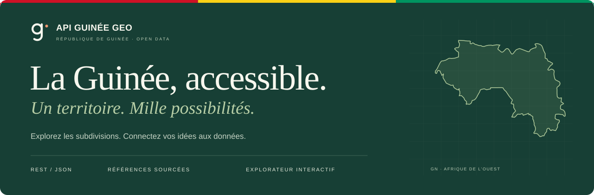
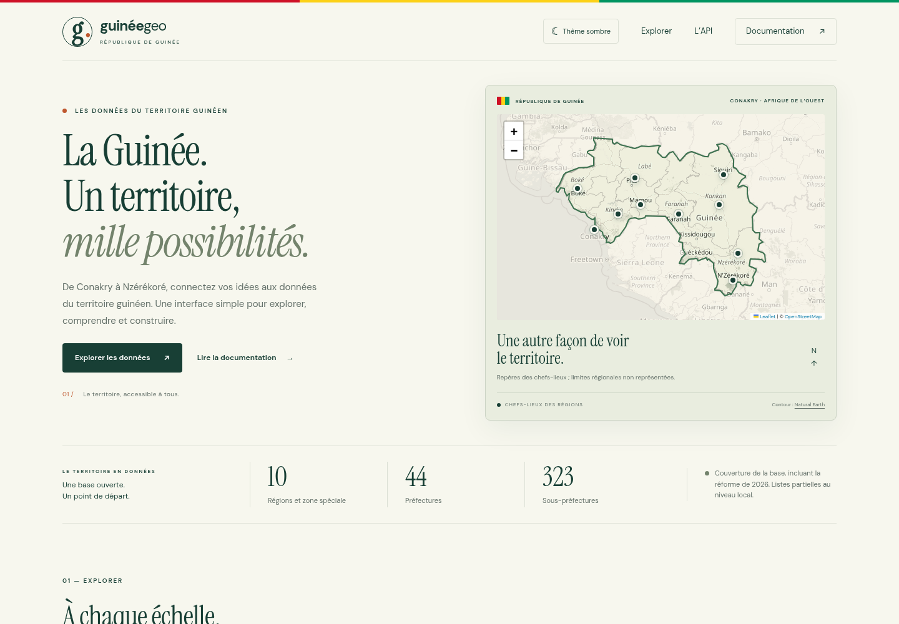

<p align="center">
  <a href="https://api-guinea-geo.vercel.app">
    
  </a>
</p>

<p align="center">
  <strong>Les données du territoire guinéen, accessibles aux développeurs et aux curieux.</strong><br>
  Une API REST publique et un explorateur pour les régions, préfectures, sous-préfectures, communes et quartiers.
</p>

<p align="center">
  <a href="https://api-guinea-geo.vercel.app">Découvrir le site</a> ·
  <a href="https://api-guinea-geo.vercel.app/#data-browser">Explorer les données</a> ·
  <a href="https://api-guinea-geo.vercel.app/api-docs/">Documentation Swagger</a> ·
  <a href="https://api-guinea-geo.vercel.app/data-sources">Sources et limites</a>
</p>

<p align="center">
  
  
  
  
</p>

---

[Présentation](#présentation) · [Données et sources](#données-et-sources) · [API](#api) · [Installation](#installation) · [Migrations](#migrations) · [Déploiement](#déploiement) · [Contribuer](#contribuer)

## Présentation

**Guinée Geo** facilite l’exploration et l’utilisation des données territoriales de la République de Guinée. Le projet associe une interface de consultation et une API en lecture, utilisables pour des outils cartographiques, des projets open data ou des applications métier.

Son principe : **chaque population exposée doit être vérifiée, datée et accompagnée de son périmètre de référence**. Les créations administratives de 2026 et les observations du recensement de 2025 sont documentées séparément.

| Explorer | Construire | Comprendre les données |
|---|---|---|
| Recherche par nom, avec ou sans accents dans l’interface | Endpoints REST et réponses JSON | Sources et pages du rapport INS |
| Fiches et navigation entre subdivisions liées | Documentation interactive Swagger | Année et périmètre des populations |
| Carte, thèmes clair/sombre et affichage mobile | Copie et téléchargement des résultats | Valeurs absentes et rattachements à confirmer signalés |

### Aperçu



La carte représente le contour national et des repères approximatifs des chefs-lieux. Elle ne représente pas les limites administratives des régions.

## Données et sources

### Couverture de la base

État vérifié lors de la publication du **10 octobre 2026** :

| Niveau | Enregistrements actifs | Couverture |
|---|---:|---|
| Régions et zone spéciale | **10** | Beyla et Siguiri intégrées ; Conakry identifiée comme zone spéciale |
| Préfectures ordinaires | **44** | Onze créations de 2026 intégrées ; Conakry exclue de ce décompte |
| Sous-préfectures | **323** | Référentiel hérité partiel après historisation des promotions |
| Communes | **13** | Communes de la zone spéciale de Conakry |
| Quartiers | **2** | Couverture très partielle |

Ces nombres décrivent **cette base**, pas une garantie d’exhaustivité nationale. Certains rattachements affectés par la réforme restent à confirmer : les liens concernés sont conservés comme anciens rattachements et marqués `parentStatus: "pending"`.

### Références vérifiées

| Données | Référence | Accès |
|---|---|---|
| Création des régions de Beyla et Siguiri | SGG — D/2026/0259/PRG/SGG, 20 août 2026 | [Décret officiel](https://sgg.gov.gn/document/downloadfile/584) |
| Onze nouvelles préfectures et leurs régions | SGG — D/2026/0258/PRG/SGG, 20 août 2026 | [Décret officiel](https://sgg.gov.gn/document/downloadfile/583) |
| Treize communes de Conakry | DGE — décisions relatives au scrutin communal du 31 mai 2026 | [Document officiel](https://www.dge.gov.gn/uploads/documents/1781875516973-CONAKRY.pdf) |
| Populations de référence 2025 | INS — RGPH-4, résultats préliminaires publiés en février 2026 | [Rapport officiel, PDF volumineux](https://www.stat-guinee.org/images/Documents/Publications/INS/rapports_enquetes/RGPH-4/Resultats_preliminaires_rgph_4.pdf) |
| Contour national | Natural Earth — Admin 0 Countries, 1:50m | [Jeu de données](https://github.com/nvkelso/natural-earth-vector/blob/master/geojson/ne_50m_admin_0_countries.geojson) |

Le référentiel démographique vérifié couvre **8 régions au périmètre de 2025, 33 préfectures et 13 communes de Conakry**, soit **54 observations**. Les contrôles des sommes et des effectifs masculins/féminins concordent avec le total national de **17 521 167 habitants**.

**Une population recensée en 2025 n’est pas une projection pour 2026.** Les chiffres des anciennes unités ne sont pas transférés aux régions et préfectures créées en août 2026. Les superficies héritées restent également à vérifier.

Les référentiels versionnés sont disponibles dans [data/administrative-update-2026.json](data/administrative-update-2026.json) et [data/populations-rgph4-2025.json](data/populations-rgph4-2025.json).

## API

**Base URL :** `https://api-guinea-geo.vercel.app`

L’API publique est accessible en lecture sans clé. La [documentation Swagger](https://api-guinea-geo.vercel.app/api-docs/) décrit les paramètres et les réponses.

### Première requête

```bash
curl --fail "https://api-guinea-geo.vercel.app/regions/search?name=Conakry"
```

Extrait de réponse :

```json
{
  "name": "Conakry",
  "population": 3407327,
  "populationReferenceYear": 2025,
  "populationStatus": "preliminary",
  "populationBoundaryCompatibility": "not-assessed"
}
```

Exemple avec le `fetch` natif de Node.js, dans un fichier `.mjs` :

```js
const response = await fetch(
  'https://api-guinea-geo.vercel.app/communes/search?name=Lambanyi'
);

if (!response.ok) throw new Error(`Erreur HTTP ${response.status}`);

const commune = await response.json();
console.log(commune.name, commune.population, commune.populationReferenceYear);
```

### Endpoints

Toutes les routes ci-dessous utilisent **GET**.

| Route | Description |
|---|---|
| `/regions` | Régions et zone spéciale présentes dans la base |
| `/regions/search?name=Conakry` | Recherche d’une région par nom |
| `/regions/stats` | Statistiques et couverture des populations vérifiées |
| `/regions/:name/prefectures` | Préfectures enregistrées d’une région, hors rattachements en attente |
| `/prefectures` | Préfectures ordinaires actives |
| `/prefectures/search?name=Kankan` | Recherche d’une préfecture par nom |
| `/prefectures/stats` | Statistiques et couverture des populations vérifiées |
| `/sous-prefectures` | Sous-préfectures actives enregistrées |
| `/sous-prefectures/search?name=Bankon` | Recherche d’une sous-préfecture par nom |
| `/communes` | Communes enregistrées |
| `/communes/search?name=Lambanyi` | Recherche d’une commune par nom |
| `/quartiers` | Quartiers enregistrés |
| `/quartiers/search?name=Almamya` | Recherche d’un quartier par nom |
| `/data-sources` | Références et limites de la mise à jour administrative |
| `/populations/rgph4-2025` | Référentiel du recensement de 2025 et total national |

Les recherches de l’API sont insensibles à la casse. Les recherches de préfectures, sous-préfectures, communes et quartiers attendent un nom complet ; celles des régions acceptent aussi une partie du nom. Les accents doivent être respectés dans les requêtes API. L’explorateur propose séparément une recherche sans distinction d’accents.

### Population et historique

| Champ | Signification |
|---|---|
| `population` | Dernière observation vérifiée, ou `null` si aucune n’est disponible |
| `populationReferenceYear` | Année de référence de l’observation sélectionnée |
| `populationStatus` | `preliminary`, `final` ou `unavailable` |
| `populationSource` | Source, date de publication et pages du rapport lorsqu’elles sont disponibles |
| `populationGeographicReference` | Périmètre territorial de l’observation |
| `populationBoundaryCompatibility` | `verified` ou `not-assessed` ; `null` sans observation |

Une valeur héritée non vérifiée ne remplace jamais une observation fiable. Les anciens chiffres sont masqués par défaut. Pour les consulter explicitement :

```bash
curl --fail \
  "https://api-guinea-geo.vercel.app/regions/search?name=Conakry&includeHistory=true"
```

La réponse ajoute `populationHistory`, comprenant la valeur héritée et les observations conservées. Le champ principal `population` reste inchangé. `includeHistory` accepte uniquement `true` ou `false`.

Les statistiques appliquent la même sélection. `totalPopulation` et les classements restent `null` si la couverture est partielle, les années diffèrent ou les périmètres actuels ne sont pas confirmés. `populationCoverage` expose notamment `verified`, `matchingCurrentBoundaries`, `total`, `referenceYear` et `complete`.

Le total national du RGPH-4 de 2025 est consultable sur `/populations/rgph4-2025` ; il est distinct d’une somme des unités administratives de 2026.

### Réponses et erreurs

| Code | Cas |
|---|---|
| `200` | Requête réussie |
| `400` | Paramètre manquant ou invalide |
| `404` | Lieu, route ou descendants recherchés non disponibles |
| `500` | Erreur interne de traitement |
| `503` | Connexion à MongoDB indisponible dans le handler Vercel |

Les erreurs applicatives renvoient un message JSON ; les erreurs internes ne divulguent pas les détails de connexion.

## Installation

### Prérequis

- **Node.js 22 ou 24** ; la production Vercel utilise Node.js 22.
- **npm** et une connexion **MongoDB** valide.
- Pour appliquer les migrations : un replica set ou un cluster MongoDB prenant en charge les transactions.

```bash
git clone https://github.com/souleymanetimbidiallo/api-guinea-geo.git
cd api-guinea-geo
npm ci
cp .env.example .env
```

Renseigner `.env` avec la connexion à votre base :

```env
MONGO_URI=mongodb://127.0.0.1:27017/guinea-geo
PORT=3000
```

Cette URL suppose qu’un serveur MongoDB local est disponible. Ne pas versionner les identifiants de connexion.

```bash
npm run dev
```

Accueil : **http://localhost:3000** · Swagger : **http://localhost:3000/api-docs/**

Le serveur démarre après la connexion à MongoDB. Pour le lancer sans rechargement automatique : `npm start`. Le port peut être modifié, par exemple avec `PORT=3001 npm start`.

### Tests

```bash
npm test
```

La suite utilise le runner natif de Node.js, des requêtes HTTP locales et des modèles simulés : elle ne nécessite pas de connexion MongoDB. **49 tests ont été validés lors de la publication du 10 octobre 2026**, couvrant les recherches, les erreurs, les migrations, les homonymes, la sélection des populations et l’historique optionnel.

## Migrations

Les migrations fournies mettent à jour **un référentiel historique déjà présent**. Elles ne constituent pas un initialiseur complet pour une base vide.

| Commande | Effet |
|---|---|
| `npm run data:check` | Simulation de la mise à jour administrative, en lecture seule |
| `npm run data:update` | Intégration des créations administratives et des communes vérifiées |
| `npm run population:check` | Vérification des correspondances démographiques, sans écriture |
| `npm run population:update` | Import des observations RGPH-4 de 2025 |

Commencer par les simulations et examiner les correspondances avant d’appliquer les mises à jour à la base définie par `MONGO_URI`.

Les imports créent une sauvegarde privée des collections concernées dans `.local/backups/`, puis utilisent une transaction MongoDB. Un échec de transaction annule les écritures. Les marqueurs `data_updates` empêchent une double application.

Les identifiants et les valeurs historiques sont conservés. Une correspondance ambiguë interrompt l’import ; les promotions administratives tiennent compte du nom **et du parent d’origine**, notamment pour les homonymes comme Dialakoro. Les observations démographiques sont stockées dans `populationObservations` et sélectionnées par la couche de réponse de l’API.

Les anciens scripts `databases/insert*.js`, lorsqu’ils sont présents localement, suppriment et recréent les collections : utiliser les migrations ci-dessus pour cette mise à jour.

## Déploiement

Le site est publié sur **[api-guinea-geo.vercel.app](https://api-guinea-geo.vercel.app)**.

- Le handler serverless est [index.js](index.js) ; [app.js](app.js) assemble les routes Express.
- [vercel.json](vercel.json) inclut les fichiers statiques, les référentiels et Swagger.
- `MONGO_URI` doit être configurée comme **secret de production** sur le projet Vercel.
- [.vercelignore](.vercelignore) exclut les variables locales, sauvegardes, anciens scripts et fichiers de développement de l’envoi.

Le déploiement publié a été vérifié avec **16 contrôles HTTP sur la version préparée**, puis **6 contrôles publics après promotion**, ainsi qu’un contrôle navigateur de l’accueil et de l’explorateur.

## Structure du projet

```text
api-guinea-geo/
├── app.js                 # Application Express et endpoints de référence
├── index.js               # Démarrage local et handler Vercel
├── controllers/           # Lecture des données et réponses HTTP
├── routes/                # Routes publiques
├── models/                # Schémas MongoDB et métadonnées
├── utils/                 # Population, statistiques, connexion et erreurs
├── data/                  # Référentiels versionnés et sources
├── scripts/               # Plans et migrations contrôlées
├── public/                # Accueil, explorateur, thèmes, carte et favicon
└── test/                  # Tests HTTP, migrations et contrat de population
```

## Contribuer

Les contributions utiles portent notamment sur les sources officielles, les rattachements administratifs, la couverture locale, les tests et l’accessibilité.

Pour proposer une mise à jour de données, préciser **la source, la date, le niveau administratif et le périmètre concerné**. Un chiffre d’une ancienne subdivision ne doit pas être attribué à une nouvelle entité sans correspondance vérifiée.

```bash
git switch -c contribution/mon-amelioration
npm test
```

Ouvrir ensuite une pull request décrivant le changement et sa validation.

## Crédits et licence

Créé par **[Souleymane Diallo](https://souleymanetimbidiallo.github.io/)**.

Le manifeste [package.json](package.json) déclare la licence **ISC**. Les données restent accompagnées des références de leurs producteurs. Le contour national utilise Natural Earth ; le fond cartographique utilise les tuiles OpenStreetMap avec attribution aux contributeurs.
